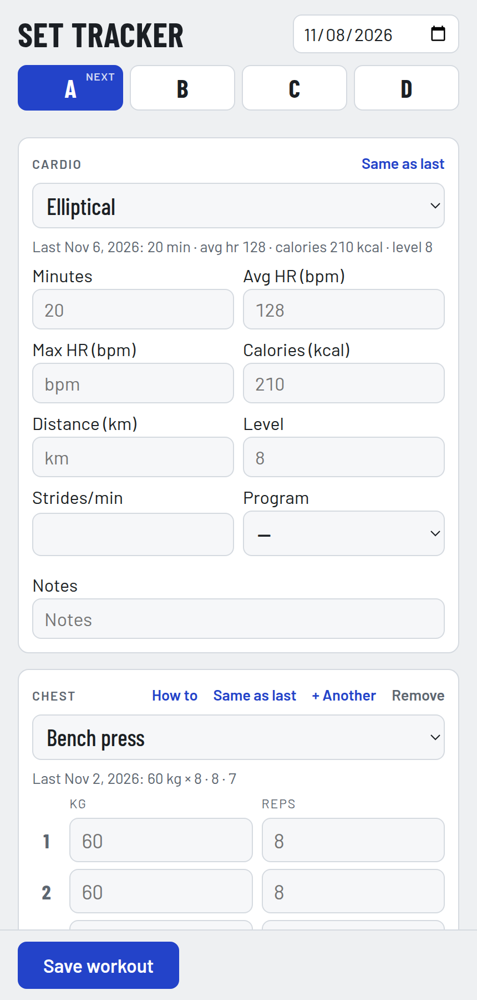

# Gym Set Tracker (Hematite): a workout log for your phone

Hematite is a one-page gym log for a four-day plan (A, B, C, D). Each exercise has three sets, and every box shows what you did last time, so you know what to beat. It also logs cardio machines. The log stays in your browser: no account, no server.

**Use it:** https://veered.org/gym-set-tracker/app/ (add it to your phone's home screen). Or open `index.html` from any web server (`python3 -m http.server`); add `?demo` to the address to see sample history.

## What it does
- **Four rotating days.** The next day in the rotation is marked; saving a workout moves to the next one.
- **Exercise groups** (Chest, Back, Legs...) with a main exercise and swaps. Add your own exercises and groups, add a second exercise to a group, remove what you don't do. A starter plan is filled in to get you going.
- **Last time** for every exercise, as placeholders in each set, and a "Same as last" button.
- **Weight + reps, reps only, or seconds** (for planks and holds). Weights in kg or lb.
- **Cardio**: elliptical, treadmill, bike, swim, rowing machine, with the numbers each display shows.
- **How to** opens a video search for the exercise's form.
- **Export**: a CSV of every set for a spreadsheet, and a JSON backup to restore on another phone.

## Privacy
Your plan and log are saved in this browser's local storage and never leave your device.

## Name
Hematite is iron ore. The stone is dark metallic gray, and ground to powder it is blood red: the red ochre of the first cave paintings. Iron, for lifting.

MIT License.
